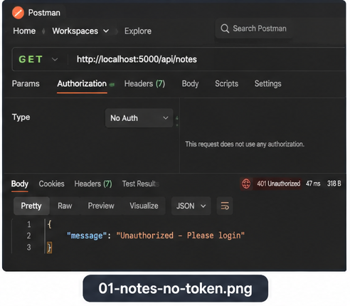
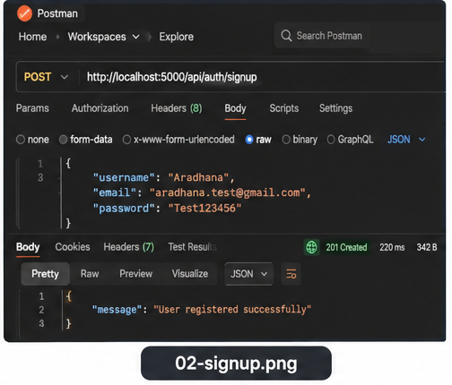
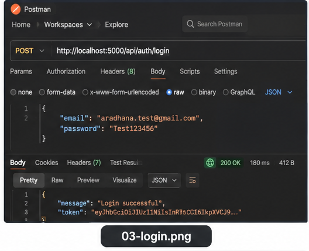
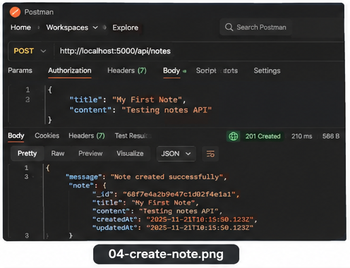
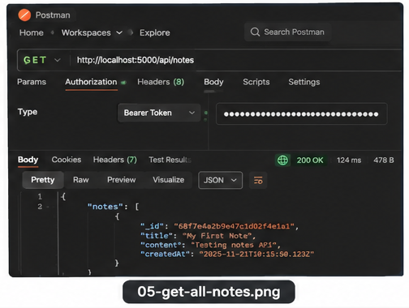
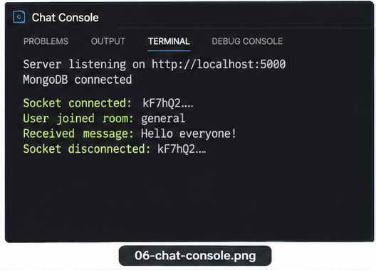
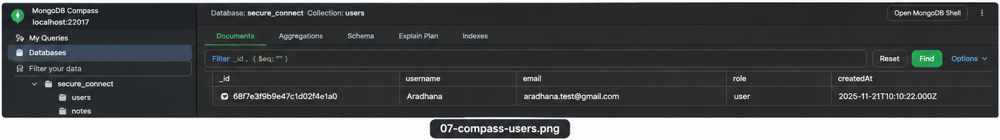

# Secure-Connect | Secure Communication Platform

A secure backend communication platform built with **Node.js, Express.js, MongoDB, JWT, and Socket.IO**, featuring user authentication, protected APIs, personal note management, and real-time messaging.

## Overview

Secure-Connect is a backend application designed to provide secure user authentication, authorization, data management, and real-time communication.

The platform combines RESTful APIs with event-driven architecture to deliver secure and reliable backend functionality.

## Features

- **User Authentication:** Secure user registration and login.
- **Password Security:** Password hashing using bcrypt.
- **JWT Authentication:** Token-based authentication for protected routes.
- **Role-Based Authorization:** Restricted access to administrative endpoints.
- **Notes Management:** Create, retrieve, update, and delete personal notes.
- **Real-Time Messaging:** Communication using Socket.IO.
- **Event-Driven Architecture:** Event handling using Node.js EventEmitter.
- **Database Integration:** Persistent data storage using MongoDB.

## Technology Stack

| Technology | Purpose |
|---|---|
| Node.js | Backend runtime |
| Express.js | REST API framework |
| MongoDB | NoSQL database |
| Mongoose | Database object modeling |
| bcrypt | Password hashing |
| JSON Web Token | Authentication |
| dotenv | Environment configuration |
| Socket.IO | Real-time communication |
| EventEmitter | Event-driven programming |
| Postman | API testing |
| MongoDB Compass | Database management |

## Project Structure

```text
Secure-Connect/
├── config/
│   └── db.js
├── events/
│   └── appEvents.js
├── middleware/
│   └── authMiddleware.js
├── routes/
│   ├── authRoutes.js
│   └── noteRoutes.js
├── screenshorts/
│   ├── 01-notes-no-token.png
│   ├── 02-signup.png
│   ├── 03-login.png
│   ├── 04-create-note.png
│   ├── 05-get-all-notes.png
│   ├── 06-chat-console.png
│   └── 07-compass-users.png
├── .env.example
├── .gitignore
├── package.json
├── package-lock.json
├── README.md
└── server.js
```

## Getting Started

### Prerequisites

- [Node.js](https://nodejs.org/)
- npm
- [MongoDB Atlas](https://www.mongodb.com/cloud/atlas) or a local MongoDB server
- [Postman](https://www.postman.com/)
- [Visual Studio Code](https://code.visualstudio.com/)

### Installation

**1. Clone the repository**

```bash
git clone https://github.com/aradhana-bit/Secure-Connect.git
```

**2. Navigate to the project directory**

```bash
cd Secure-Connect
```

**3. Install dependencies**

```bash
npm install
```

**4. Configure environment variables**

Create a `.env` file in the root directory.

```env
PORT=5000
MONGODB_URI=your_mongodb_connection_string
DB_NAME=secure_connect
JWT_SECRET=your_long_random_secret
JWT_EXPIRES_IN=1h
```

Replace the placeholder values with your actual configuration.

**5. Start the application**

```bash
npm start
```

The application runs locally at:

`http://localhost:5000`

## API Documentation

**Base URL:** `http://localhost:5000`

### Authentication

| Method | Endpoint | Description |
|---|---|---|
| POST | `/api/auth/signup` | Register a new user |
| POST | `/api/auth/login` | Authenticate an existing user |

### Protected Routes

| Method | Endpoint | Description |
|---|---|---|
| GET | `/api/profile` | Retrieve authenticated user profile |
| GET | `/api/admin` | Access the admin-protected endpoint |

Protected endpoints require a valid JWT.

**Authorization Header:**

```http
Authorization: Bearer YOUR_JWT_TOKEN
```

### Notes Management

| Method | Endpoint | Description |
|---|---|---|
| POST | `/api/notes` | Create a note |
| GET | `/api/notes` | Retrieve user notes |
| PUT | `/api/notes/:id` | Update a note |
| DELETE | `/api/notes/:id` | Delete a note |

### Example: Create a Note

**POST** `/api/notes`

```json
{
  "title": "My First Note",
  "content": "Testing Secure Connect Notes API"
}
```

### Example: Update a Note

**PUT** `/api/notes/NOTE_ID`

```json
{
  "title": "Updated Note",
  "content": "Note updated successfully"
}
```

Replace `NOTE_ID` with the actual note ID.

## Real-Time Communication

Secure-Connect integrates Socket.IO to enable real-time communication between connected users.

### Socket.IO Events

| Event | Description |
|---|---|
| `connect` | Establishes a socket connection |
| `join_room` | Joins a designated chat room |
| `chat_message` | Handles real-time messages |
| `disconnect` | Handles socket disconnection |

### Communication Workflow

1. Client establishes a Socket.IO connection.
2. Server handles connection authentication.
3. User joins a designated chat room.
4. Messages are exchanged through Socket.IO events.
5. Connected participants receive real-time messages.

## Database Architecture

**Database:** `secure_connect`

| Collection | Description |
|---|---|
| users | Stores registered user information |
| notes | Stores user-created notes |

### Users Collection

- Username
- Email
- Hashed password
- User role
- Account creation timestamp

### Notes Collection

- Note title
- Note content
- Associated user
- Creation timestamp
- Update timestamp

## Output Screenshots

### Authentication and Authorization

**Unauthorized Notes Access**



**User Registration**



**User Login and JWT Authentication**



### Notes Management

**Create Note**



**Retrieve All Notes**



### Real-Time Communication

**Socket.IO Chat Console**



### Database Verification

**MongoDB Compass – Users Collection**



## Security

- Password hashing using bcrypt.
- JWT-based authentication.
- Protected API routes.
- Role-based authorization.
- Environment-based secret management.
- User-specific note access.
- Authenticated Socket.IO connections.

## Future Enhancements

- Interactive frontend application.
- Private one-to-one messaging.
- Improved chat room management.
- User profile management.
- Password recovery functionality.
- Message history and timestamps.
- Enhanced request validation.
- Automated testing and API documentation.

## Author

**Aradhana**

[GitHub Profile](https://github.com/aradhana-bit)

---

**Secure-Connect** — Building secure connections through modern backend technologies.